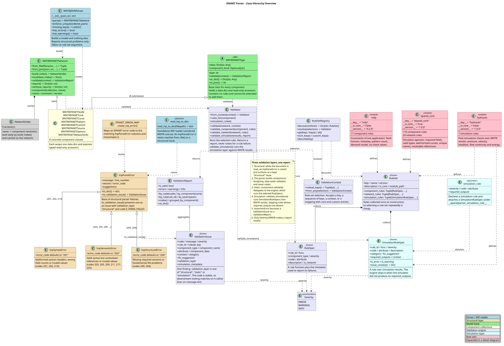
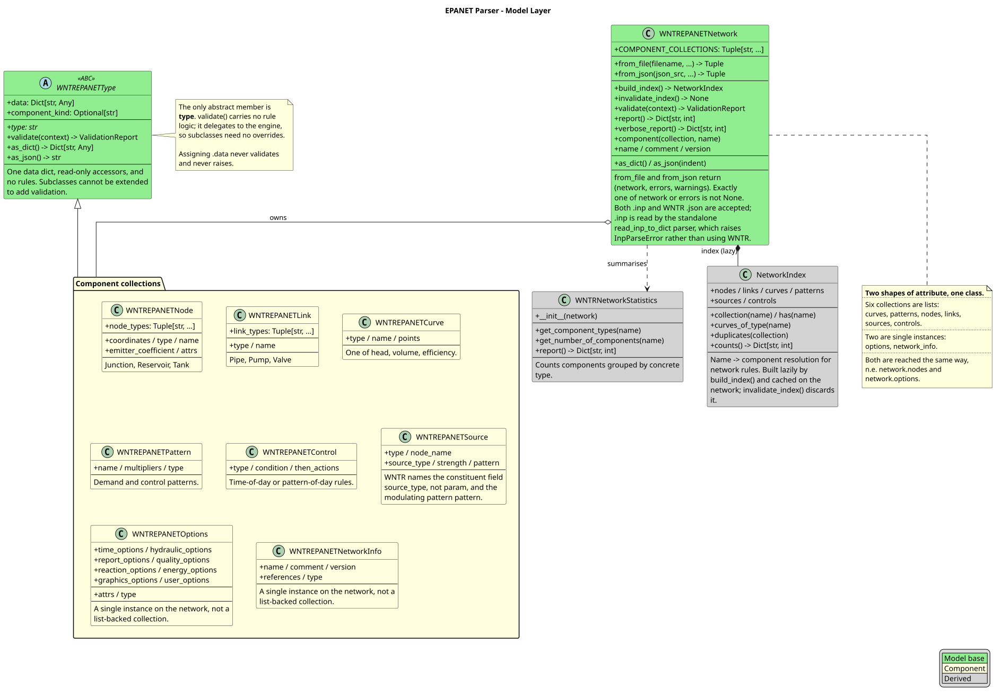
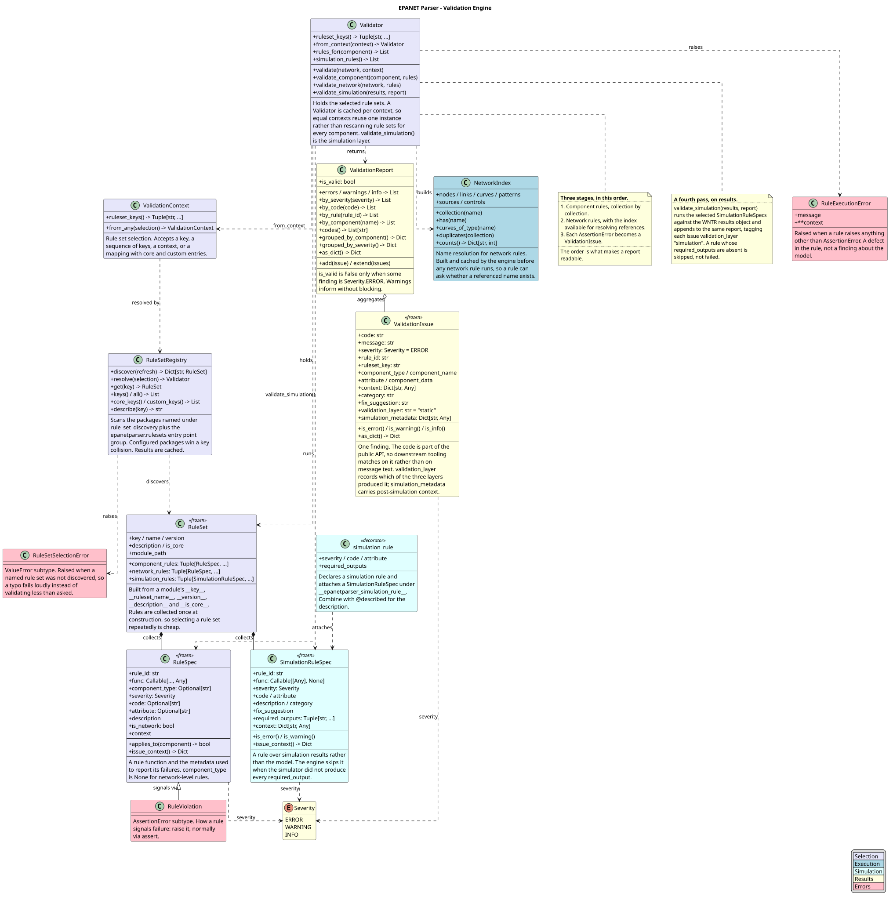
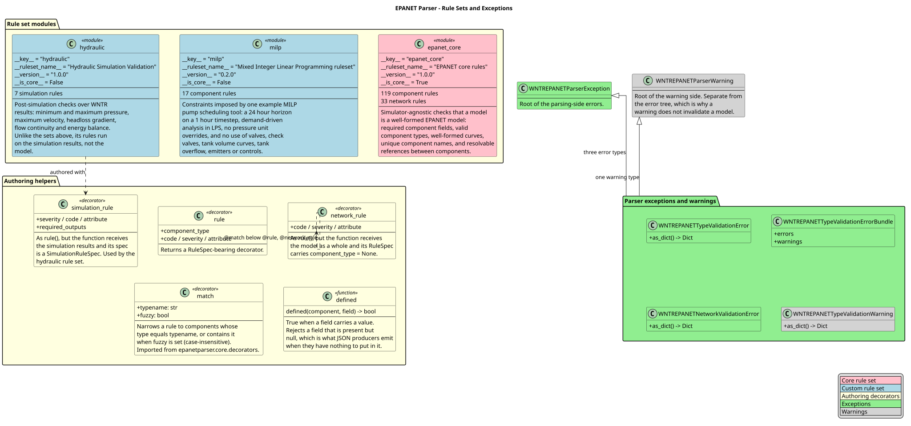

Class Hierarchy
===============

epanetparser is organised as four separate stages, and validation happens
in three layers that all converge into one report:

.. code-block:: text

    EPANET input
        |
        v
    Parser                    builds a model; reports structural problems only
        |                     LAYER 1 (structural): InpParseError -> issue
        v
    EPANET model              WNTREPANETType subclasses, no rules
        |
        v
    Static validation         simulator-agnostic; LAYER 2 returns issues
        |                     tagged validation_layer="static"
        v
    Simulator                 optional; runs only on demand
        |
        v
    Simulation validation     LAYER 3: @simulation_rule over WNTR results

All three layers append to the same ``ValidationReport``, so callers see one
result with every issue tagged ``validation_layer``. The four diagrams below
follow that pipeline. Each is generated from a PlantUML source file beside
it, so the diagrams and the code can be checked against each other.

Overview
--------

The whole system in one view. The eight component classes and the
exception hierarchy are collapsed into stub boxes, each labelled with its
real member count; both are expanded in the later diagrams.

The data flow is the part worth reading. The parser builds components and
stops. ``component.validate()`` delegates to the engine, holding no rule
logic of its own, so subclasses need no overrides. The registry selects rule
sets, the validator runs each ``RuleSpec``, and each ``AssertionError``
becomes a ``ValidationIssue`` on a ``ValidationReport``.

Assigning ``.data`` never validates and never raises. That is a guarantee
of the design, not an accident: it is why no component class is subclassed
or patched to add validation.

Model layer
-----------

The eight concrete component classes, the network that owns them, and the
lazy name index. The two shapes of attribute are shown on the network:
six list-backed collections (``curves``, ``patterns``, ``nodes``,
``links``, ``sources``, ``controls``) and two single instances
(``options``, ``network_info``), all reached the same way.

   

``WNTREPANETType`` has exactly one abstract member, ``type``. The
``validate()`` method on it is a delegation point, not an implementation.

Validation engine
-----------------

Everything in :mod:`epanetparser.core.validation`. A rule failure never
raises: ``validate()`` returns a report. A rule that raises anything other
than ``AssertionError`` is itself defective, and raises
``RuleExecutionError`` instead — a broken rule silently reporting nothing
would let an invalid model pass.

   

Static validation runs in three passes, and the order is what makes a report
readable:

1. component-level rules, collection by collection;
2. network-level rules, with the name index available for resolving
   references;
3. each ``AssertionError`` becomes a ``ValidationIssue``.

The structural layer
--------------------

Structural failures are raised while a document is read, before any network
object exists, so they cannot come from a rule. They are the first of the
three layers. ``InpParseError`` is the base of that tree:

- ``InpSyntaxError`` — malformed section headers, wrong field counts and
  invalid values (EPANET codes 201, 202, 213).
- ``InpSemanticError`` — valid syntax but unresolved references or invalid
  values (codes 203, 205, 209, 211, 217, 225).
- ``InpStructuralError`` — missing required sections or fundamental file
  problems (codes 200, 204).

``EPANET_ERROR_MAP`` and ``create_inp_error`` map an EPANET code to the
matching subclass. A caught error reaches callers through
``InpParseError.to_validation_issue()``, which returns a ``ValidationIssue``
tagged ``validation_layer="structural"``, code ``E_PARSE_FAILED``, with the
parser's line number, section, error code and suggestions preserved in its
``context``. These classes live in
:mod:`epanetparser.core.io.inp_errors`.

The simulation layer
--------------------

After a hydraulic simulation, rules declared with ``@simulation_rule`` are run
by ``Validator.validate_simulation(results, report)`` against the WNTR results
object rather than the model. Each decorated function carries a
``SimulationRuleSpec`` whose ``required_outputs`` (for example
``"node.pressure"``) are checked before the rule runs: a rule whose outputs
the simulator did not produce is skipped, not failed. Failures append to the
same ``ValidationReport`` as the static layer, tagged
``validation_layer="simulation"``. The ``hydraulic`` core dynamic rule set
(``epanetparser.core_rules.core_dynamic.hydraulic``) is the built-in example;
its result-table schemas live beside its rules in ``schemas.py`` and depend on
the optional ``pandera`` package (``epanetparser[schemas]``). See
:doc:`simulation_validation`.

Every issue, from any layer, carries structured metadata including:

- ``category``: The validation category (Topology, Parameter, Curve, Control,
  Network, Option, Energy, Engineering)
- ``fix_suggestion``: An imperative remediation hint for AI agents
- ``component_data``: Full data dictionary of the validated component
- ``context``: Additional metadata (ruleset, component subtype, failing fields)
- ``validation_layer``: Which of ``"structural"``, ``"static"`` or
  ``"simulation"`` produced the issue
- ``simulation_metadata``: Post-simulation context, such as the rule's
  ``required_outputs``

Only ``Severity.ERROR`` makes a report invalid.

Rule sets and exceptions
------------------------

The modules that define rules, the decorators used to write them, and the
exception taxonomy.

   

The core/custom split is the distinction the architecture exists to
express. ``epanet_core`` states what EPANET itself requires, like a
compiler's static checks. A custom set such as ``milp`` states what one
particular formulation can handle. A model can be a valid EPANET model and
still be unusable by a given tool, and both statements are true of the same
object at the same time.

That is also why some rules moved out of the core set. A fixed pattern
length, a fixed horizon and a fixed timestep are application assumptions,
not EPANET ones, so they live in ``custom_rules/milp.py``.

Adding a rule changes nothing else — no registry entry, no import
elsewhere, no base class to subclass. Drop a module into a package listed
under ``rule_set_discovery`` and it is discovered. Severity follows the
function name: ``rule_*`` reports ``ERROR``, ``warn_*`` reports
``WARNING``. Decorator order is ``@rule`` outermost with ``@match`` below
it.

Rules can be declared explicitly with ``@rule``/``@network_rule`` decorators,
or implicitly via naming convention: functions named ``rule_*`` (ERROR) or
``warn_*`` (WARNING) are auto-discovered. The component type is inferred
from the first parameter's type annotation. Network rules must use
``@network_rule`` explicitly. ``collect_rules()`` scans a module for both
styles, using ``__module__`` to avoid duplicate collection of re-exported
functions.

A rule set is not limited to the model, and a rule set module is not limited
to one layer. The ``hydraulic`` core dynamic set declares ``@simulation_rule``
functions, collected into the same ``RuleSet`` as its ``simulation_rules``
and run by the simulation layer after a hydraulic run. The ``milp`` custom
set mixes layers the other way: static component rules plus one simulation
rule in one module. Each rule set declares its primary layer with
``__layer__`` (``"static"`` or ``"dynamic"``), each rule spec carries its own
``layer``, and selection keeps the roles apart: the core slot must resolve to
the static core rule set, while the dynamic core rule set is selected as a
custom rule set.

.. note::

   These diagrams describe the codebase as it stands. If the model layer
   changes, they need regenerating along with it. The PlantUML sources and
   their rendered SVG/PNG copies live in ``docs/source/diagrams/``.
   Regenerate every diagram from the ``docs/`` directory with
   ``make diagrams``, which runs ``docs/diagrams/render_diagrams.sh`` using
   the vendored PlantUML jar at ``docs/diagrams/tools/plantuml.jar``. A Java
   runtime is the only external requirement.
